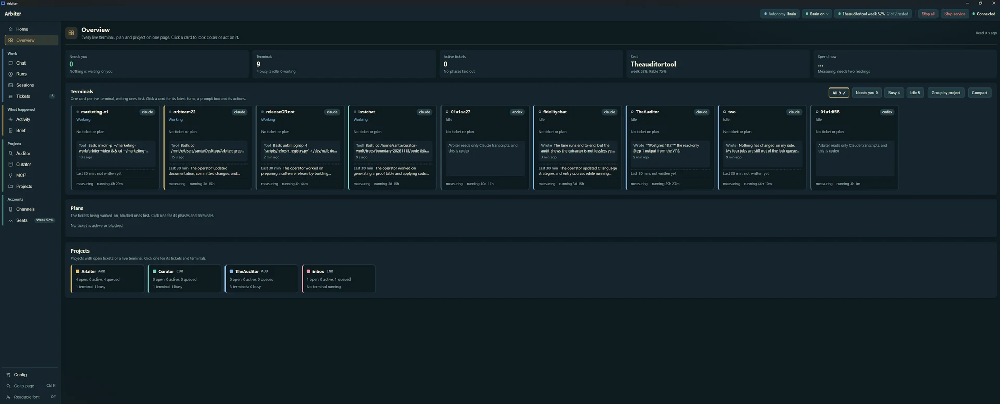
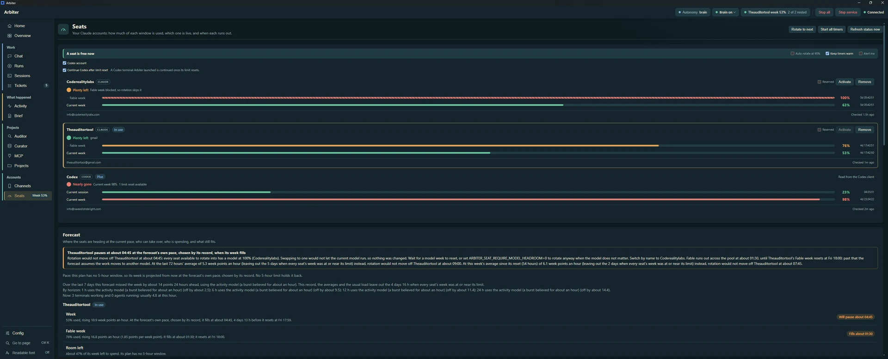
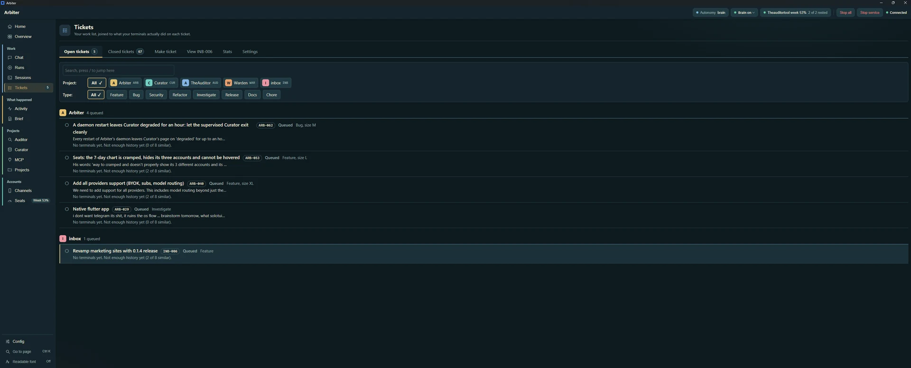
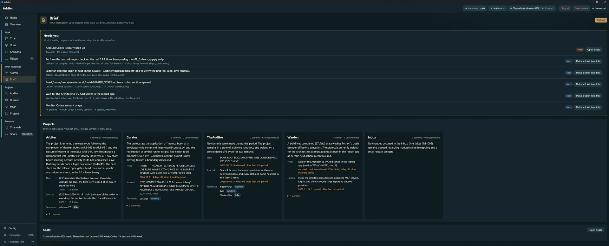
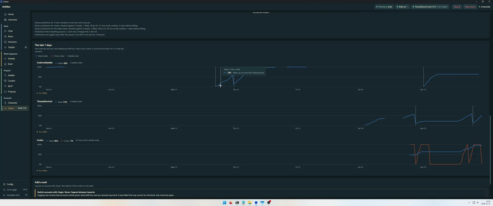

# Arbiter

**Stop babysitting Claude Code and Codex.** Arbiter is one desktop app for everything around your
coding agents: every terminal on one screen, a forecast of when your Claude limit runs out, your
agents on your phone, and a clean pickup after a reboot.

**When Codex hits its usage limit, Arbiter can pick up the run after reset.**

**[arbitermcp.com](https://arbitermcp.com)** · [Watch the 5:40 tour](https://youtu.be/yvzHejrm77Y) ·
[Blog](https://blog.arbitermcp.com) · Windows and Linux · Free during the pre-release

[](https://arbitermcp.com/#demo)

> ## Release status
>
> **Arbiter 0.1.4 is the current public pre-release** (November 16, 2026), for Windows 10 and 11
> and 64-bit Linux. It is free until March 31, 2027: ask for a license at
> [arbitermcp.com](https://arbitermcp.com/#get) and the key arrives by email.
>
> New in 0.1.4: Codex on the Seats page, Codex terminals that carry on by themselves when their usage
> limit resets, an Overview that says what each terminal did, and a 7-day usage chart. Every change, release
> by release, is in the [changelog](CHANGELOG.md).

## Get it running

| Platform | Download | Notes |
|---|---|---|
| Windows 10 or 11, x64 | [`Arbiter_0.1.4_x64-setup.exe`](https://github.com/TheAuditorTool/ArbiterMCP/releases/download/v0.1.4/Arbiter_0.1.4_x64-setup.exe) (85 MB) | or [`Arbiter_0.1.4_x64_en-US.msi`](https://github.com/TheAuditorTool/ArbiterMCP/releases/download/v0.1.4/Arbiter_0.1.4_x64_en-US.msi) |
| Debian, Ubuntu and derivatives, x64 | [`Arbiter_0.1.4_amd64.deb`](https://github.com/TheAuditorTool/ArbiterMCP/releases/download/v0.1.4/Arbiter_0.1.4_amd64.deb) | `sudo apt install ./Arbiter_0.1.4_amd64.deb` |
| Any Linux, x64 | [`Arbiter_0.1.4_amd64.AppImage`](https://github.com/TheAuditorTool/ArbiterMCP/releases/download/v0.1.4/Arbiter_0.1.4_amd64.AppImage) | glibc 2.34 or newer, WebKitGTK 4.1 |
| Engine only, no desktop app | `arbiter-0.1.4-windows-x64.zip`, `arbiter-0.1.4-linux-x64.tar.gz` | on the [release page](https://github.com/TheAuditorTool/ArbiterMCP/releases/tag/v0.1.4) |

1. **Download** the file for your system.
2. **Get your free key** at [arbitermcp.com](https://arbitermcp.com/#get). It runs until March 31, 2027,
   with every feature included.
3. **Open Arbiter** and paste the key on the first screen. Arbiter finds your Claude Code and Codex, and
   offers the optional local model when you want it.

Windows will warn that it protected your PC, because this build is not code-signed yet: choose
**More info**, then **Run anyway**. If you want to check the file first, see
[Check what you downloaded](#check-what-you-downloaded).

## Why it exists

Claude Code and Codex are great at one session. Run five at once and the work around them lands on you:

- **Twelve terminals, one memory.** The only map of what each agent is doing lives in your head.
- **The limit hits mid-task.** You learn your weekly limit is gone when the agent stops.
- **You can't leave the desk.** An agent that needs an answer waits until you are back.
- **Nobody knows what it cost.** A feature took three sessions over two days, and nobody wrote down the tokens.

Arbiter does not write your code. It runs the clients that do, with the logins you already have, and
takes care of everything around them. It started as the tool its maker needed to keep a dozen coding
agents moving across several products, and it is used every day to build them.

## What it does

### Every terminal on one screen

Launch Claude Code and Codex terminals from the app, or let Arbiter find the ones you started yourself.
One page shows which are working, which are idle and which are waiting on you, with a "Needs you" count
so a waiting agent never sits unnoticed. Click a card to read its latest turns, send it a prompt or act
on it. Sessions run natively on Windows 10 and 11, with no Linux layer required, and on Linux.

### Know when your limit runs out, before it does

Arbiter reads your Claude usage and projects when your weekly limit fills at the pace you are working,
model limits included. It replays its own predictions over the past week and tells you how far off it
was, so you know how much to trust it. Track one Claude account or several side by side, with your Codex
account beside them.



### Your agents, in your pocket

Connect Telegram (WhatsApp and Signal are in beta) and supervise from anywhere: see what a session did and
what it waits on, send it more work, approve a plan, attach photos and files to a ticket, or stop
everything. Two-factor approval is on the moment you connect a channel, every action from the phone needs
a code from your authenticator app, and an approval binds to the one request that asked for it. The
phone's commands work on every machine; requests in plain words are answered by the local model, so they
need it running.

### Find out what a feature actually cost

Tickets join your work list to what your terminals really did. Time, tokens, cost, edited files and
commits are booked to a ticket only when Arbiter can prove which session did the work, and estimates come
from your own closed tickets. Split long work into phases so a relaunched terminal picks up where it was,
and let agents read the documents and screenshots attached to a ticket.



### A morning brief from a model on your own card

Arbiter runs a local model on your graphics card. Open the Brief, or schedule it for the morning, and it
tells you what changed in each project since you last looked and ranks what needs you next. Ask it in chat
to check a terminal or file a ticket, with no cloud call in the loop. The local model is optional: it needs
8 GB of graphics memory, and everything else runs without it.



### A reboot is not a mystery anymore

After a crash, an update or a power cut, Arbiter accounts for every interrupted run on its own. Each one
gets a known state, safe read-only work is re-run, and anything with side effects waits for you. Relaunch a
terminal into the same conversation with one click.

## One app instead of five

| Without Arbiter | With Arbiter |
|---|---|
| A dozen terminal windows and a mental map | One page of live terminals, launched and relaunched from the app |
| A separate usage monitor | A forecast that measures its own track record |
| A separate chat bridge for remote control | Phone control where every action needs a 2FA code |
| A spreadsheet for what a feature cost | Tickets that book time, tokens and cost from the sessions that did the work |
| Scrollback archaeology after a crash | A known state for every interrupted run |

## Watch the tour

[](https://youtu.be/yvzHejrm77Y)

A silent, unedited 5:40 screen capture of the app on a real working day: live terminals, the usage forecast,
tickets, the brief, the phone channel and the settings. Also on [arbitermcp.com](https://arbitermcp.com/#demo).

## Requirements

| | |
|---|---|
| **Windows** | 10 or 11, 64-bit |
| **Linux** | 64-bit, glibc 2.34 or newer. The desktop app needs WebKitGTK 4.1. |
| **Coding clients** | Claude Code, Codex, or both, signed in with your own accounts |
| **Graphics card** | Optional. The local model needs 8 GB of graphics memory and a driver with Vulkan support, which current NVIDIA, AMD and Intel drivers have. A card with 10 GB or more runs it at its full context window; an 8 GB card runs a smaller quantization of the same model. On a card with less, the local model does not start and the rest of Arbiter works. |
| **Local model** | A separate download of about 5 to 7 GB (Gemma 4, Apache 2.0 license, from Hugging Face; no account needed). The Windows setup offers it at the end, the app offers it on every page until it is in place, and `arbiter setup-llm` downloads it on a machine without the app. |
| **Internet** | To activate the license and check in with the license server |
| **macOS** | Not supported yet |

## Privacy and security

- **Local-first.** Your terminals, tickets and history stay on your computer, and no Arbiter server sits
  between you and your agents: the phone channel talks to your own private Telegram bot.
- **Telemetry you control.** Three levels, Off, Lite and Full. It never sends prompts, code, file names,
  paths, project names or keys.
- **A second factor that stays yours.** Nothing your agents can read or write on your machine counts as your
  second factor.
- **Verifiable downloads.** Every release file is listed with its SHA256 in a signed checksum file and ships
  with a software bill of materials.

## Check what you downloaded

Every file is listed with its SHA256 in `arbiter-0.1.4-<os>-x64.SHA256SUMS`, signed with the Code Reality
Labs release key `arbiter-release-signing-key.asc` (fingerprint
`0CF6 23D6 6975 AC42 EF02 A1EA 98F3 6798 1E68 D3E3`), all attached to the release.

```
gpg --import arbiter-release-signing-key.asc
gpg --verify arbiter-0.1.4-linux-x64.SHA256SUMS.asc arbiter-0.1.4-linux-x64.SHA256SUMS
sha256sum -c --ignore-missing arbiter-0.1.4-linux-x64.SHA256SUMS
```

On Windows, `Get-FileHash .\Arbiter_0.1.4_x64-setup.exe` in PowerShell prints the SHA256 to compare with its
line in `arbiter-0.1.4-windows-x64.SHA256SUMS`; GnuPG for Windows (Gpg4win) checks the signature with the
same `gpg --verify` command.

## Questions

**Is it free?** Yes, during the pre-release. Ask for a license at [arbitermcp.com](https://arbitermcp.com/#get)
and it runs until March 31, 2027.

**Does it replace Claude Code or Codex?** No. Arbiter drives the Claude Code and Codex you already have
installed and signed in. It never runs the coding turns itself.

**Do I need a graphics card?** No. Only the optional local model does.

**Is there a Mac version?** Not yet.

**Is it open source?** No. Arbiter is proprietary software made by Code Reality Labs; this repository is its
public release channel. Bug reports and feature requests are welcome in
[Issues](https://github.com/TheAuditorTool/ArbiterMCP/issues).

## Follow development

- Product: [arbitermcp.com](https://arbitermcp.com)
- Engineering journal: [blog.arbitermcp.com](https://blog.arbitermcp.com) ([RSS](https://blog.arbitermcp.com/rss.xml))
- Made by: [Code Reality Labs](https://coderealitylabs.com)

## License

Arbiter is proprietary software. Copyright (C) 2026 Code Reality Labs. All rights reserved.

See [LICENSE](LICENSE) for terms. Commercial licensing and partnership inquiries:
[Code Reality Labs](https://coderealitylabs.com).
